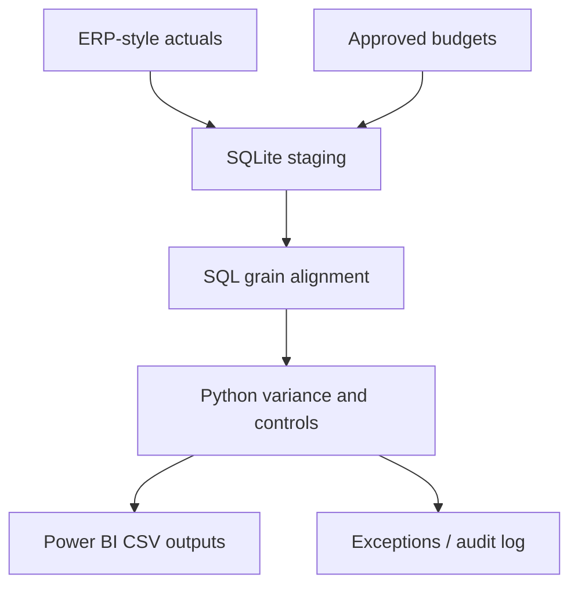

# Budget vs. Actual Automation | SQL · Python · Power BI

An end-to-end **synthetic FP&A portfolio project** converting ERP-style actuals and approved budgets into reproducible variance analysis, exceptions, baseline forecasts, and Power BI-ready data.

> All data is fabricated. No real employer/client data is used.

## Quick start

Python 3.10+; no third-party dependencies.

```bash
python -m budget_automation seed
python -m budget_automation run --through 2026-09
python -m unittest discover -s tests -v
```

The seed creates 12 months of deterministic FY2026 transactions and approved budgets in `data/finance_demo.sqlite`. The run produces:

| File | Content |
|---|---|
| `output/variance_detail.csv` | Month/department/GL budget, actual, variance, controls |
| `output/department_summary.csv` | Department YTD through selected close month |
| `output/forecast.csv` | FY Budget, YTD Actual, remaining budget, baseline EAC |
| `output/exceptions.csv` | Material spend and unmatched lines |
| `output/run_audit.json` | Run ID, timestamps, reconciled totals, checksums |

## Design



- **Grain:** month × department × GL account.
- **Variance:** expense actual − approved budget. Positive = unfavorable.
- **Data controls:** full-key SQL join, unique transaction IDs, source total reconciliation, budget version filter.
- **Materiality:** `HIGH_RISK` when variance > $10,000 **and** >10%. `DATA_REVIEW` for unmatched budget/actuals. Thresholds are hypothetical.
- **Baseline forecast:** EAC = actual through close month + approved budget for remaining months. This is not a predictive model; add headcount and spend drivers before business use.

## Build the Power BI report

Follow [`powerbi/POWER_BI_GUIDE.md`](powerbi/POWER_BI_GUIDE.md) and load the output CSVs via **Get data → Text/CSV**. Different aggregation levels should remain separate tables without many-to-many joins. A real `.pbix` report must be saved using Power BI Desktop; this repository provides the reproducible data and DAX guide, not a fabricated report screenshot.

## Controls and limitations

1. This MVP models **expense** accounts only, not revenue favorable/unfavorable conventions.
2. A real ERP connector must normalize debit/credit signs, periods, currencies, subsidiaries, and account mappings first.
3. SQLite `REAL` and rounded reporting values are for teaching; production finance workflows should use decimal or integer cents.
4. Real-world approvals, close locks, reversals, access controls and late journals require additional controls.
5. `data/` and `output/` are generated and ignored by Git. Re-run the commands to reproduce.

## Portfolio description

Built a synthetic FP&A automation case study using SQL and Python to aggregate ERP-style transactions, reconcile them to approved budgets, flag material variance and mapping exceptions, calculate a simple full-year forecast, and prepare auditable Power BI reporting outputs.

## Roadmap

- [x] 12-month demo dataset, SQL query, exceptions, forecast and audit output
- [x] Automated unit tests and GitHub Actions
- [ ] Assemble and save a real Power BI `.pbix` report
- [ ] Add driver-based forecast and scheduled refresh
